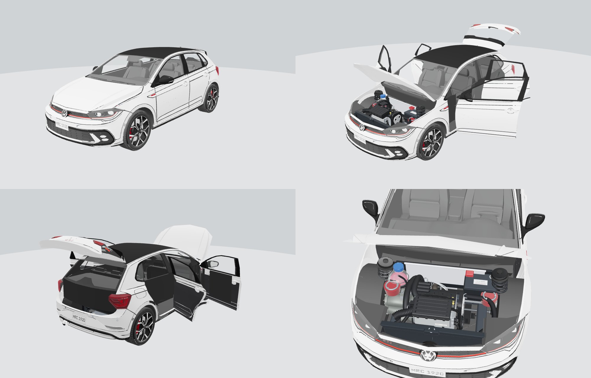
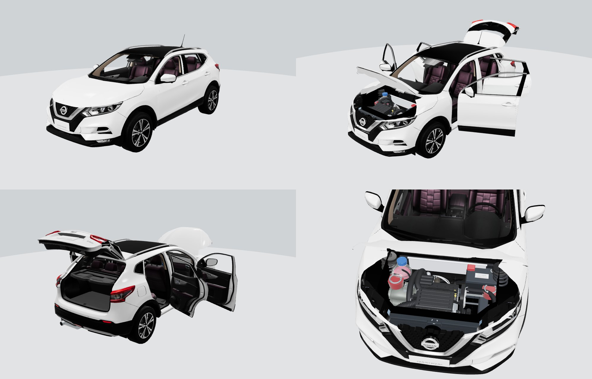

# The GLB machine

Ask for a car in plain words and get back an interactive GLB: every door, the
bonnet and the tailgate open (glTF animation clips), the glass is clear, the
model's cabin is kept, and a generic engine bay and exhaust sit under it,
painted the colour asked for. Python (numpy, scipy, Pillow) and Node; **no
Blender**, no GPU. ExpertCarCheck's own software: see `LICENSE` and, for every
component and the car models' licences, `THIRD_PARTY.md`.

## Install and run

```
pip install -r pipeline/realcar/requirements.txt
python3 pipeline/realcar/glbmachine.py setup          # npm install + work folder (~/.glbmachine)
python3 pipeline/realcar/glbmachine.py make "Nissan Micra 2004 red"
python3 pipeline/realcar/glbmachine.py make "Ford Fiesta 2012 blue" --no-sheet
python3 pipeline/realcar/glbmachine.py batch --top 20 --workers 3
python3 pipeline/realcar/glbmachine.py serve --port 8080
```

Or as one image (Python, Node 22, Chromium):

```
docker build -f pipeline/realcar/Dockerfile -t glbmachine .
docker run -p 8080:8080 -v glbdata:/data -e GLBMACHINE_KEYS=key1,key2 glbmachine
docker run --rm -v glbdata:/data glbmachine make "Toyota Yaris 2003 silver"
```

The web API (`serve`): `POST /v1/cars {"request": "...", "spec": "...",
"sheet": false}` answers with an id; `GET /v1/cars/ID` gives the status and
the report; `GET /v1/cars/ID/car.glb` and `/sheet.jpg` give the files;
`GET /v1/cars` lists the last 40 cars and `GET /v1/catalogue` every make,
model and year the catalogue has. With `GLBMACHINE_KEYS` set, each call
needs `Authorization: Bearer KEY`, which is where licence keys plug in.

## The Maker: the program in one page

`glbmachine serve`, then open the machine's address (`http://localhost:8080`).
The page that opens is the whole program:

1. **Make, Model**: type them; the lists offer what the catalogue has and
   the line under them gives its years.
2. **Year or plate**: `2012`, or a UK plate, `12` (March 2012) or `62`
   (September 2012).
3. **Spec** (optional): as a car check gives it. A badge the catalogue has
   as its own model picks that model (`GTI` with a Golf, `GR` with a
   Yaris, `Type R` with a Civic). A trim name (`ST-Line`, `R-Line`,
   `M Sport`) or an engine keeps the standard body, and the report says
   so. Doors (`5dr`) and body (`hatchback`) in it count too.
4. **Doors** and **Colour**: the DVLA colour names.
5. **Build GLB**: a clock runs against the two minutes. Catalogue cars take
   5-20 s, or about 25 s more with the four-view picture ticked.

The car then opens in 3D with every door, the bonnet and the tailgate open:
- drag to turn it, the wheel to zoom, and go all the way round, underneath
  too;
- **Doors**, **Bonnet**, **Tailgate** and **Open all** shut and open them;
- **Spin** turns it on its own;
- **Flip** turns it over to show the floor, the engine from below and the
  exhaust;
- **Picture** saves the view as a PNG;
- **Download GLB** gives the file for the app.

Beside the car is what was built: the catalogue model and how it matched
the year, what opens, what is missing, the paint, the model's credit and
licence (with whether commercial use is allowed), and the time each step
took. **Fix a part in Studio** opens the same car in GLB Studio. **Recent**
lists every car built, so you can open any of them again.

## GLB Studio: fix a car by hand

When the machine gets a part wrong (a welded bonnet it could not find, a
boot lid cut wrong, stray sheets in the bay), open the car in the Studio:

```
python3 pipeline/realcar/glbmachine.py serve --port 8080   # then http://localhost:8080/studio/
```

1. Pick the car from the list (every car built here that kept its rig).
2. Click a panel: the selection grows from that face to the nearest crease or
   shut line (*Panel*), takes a whole loose piece (*Piece*), or everything
   facing you in a box you drag (*Box*). Shift adds, Alt takes away.
3. Say what it is: Bonnet (B), Tailgate (T), a door (1-4), Body (0) or
   Remove (Del). Ctrl-Z undoes. A coloured line shows where each part will
   hinge; change the edge (a rear-hinged door, a side-hinged tailgate) or the
   angle in the parts list.
4. Build car: the server applies the edits to the rigger's own parts
   (`edits.py`, kept apart so they can be changed or undone at any time) and
   finishes the car again (`finish.py` takes hand-set parts as they are).
   About 5 s. The Result view opens each part.

Tested 2026-10-16: the Qashqai J11 and the Fiat 500e, both "bonnet missing",
fixed with one click and one key each; both now build with everything
opening. "Back to automatic" throws the edits away. The edits are saved with
the car, so later rebuilds (and batch runs) keep them.

## Ask for a car

Your catalogue only: no Sketchfab, no outside service. The only network use
is fetching the model file from the catalogue's own storage.

```
glbmachine make "Vauxhall Corsa 2012 red" -o corsa.glb           # web GLB (meshopt)
glbmachine make "Vauxhall Corsa 2012 red" --full -o corsa.glb    # opens in any 3D program
```

The steps, in order:
1. The approved catalogue is searched for that model in a generation on
   sale that year. If it has the model but not that generation, the nearest
   generation is built and the report says so (`--exact` refuses instead).
   If it has no such model, the report lists what it has for that make.
   Among records that fit as well, the plain body comes before a long or
   special one (Allspace, Tiguan L, LWB), the newer generation first, then
   one ExpertCarCheck may use commercially, then the newest and best graded.
   A generation still built somewhere after its successor came (the Tiguan
   Mk2, kept on in China) counts as on sale only until the successor starts.
   A model the rigger cannot use (its wheels and doors fused into a few
   shells) is passed over for the next best, up to three. The report lists
   it under `passed_over`, with the reason.
2. The file is decoded (`decode.mjs`), rigged (`rig.py`), finished in the
   colour asked for (`finish.py`), validated, compressed and, unless
   `--no-sheet`, drawn on a four-view check sheet; `-o` writes the GLB
   where you want it.
3. The credit written into the file (`asset.copyright`) comes from the
   catalogue record: title, author, licence, link. Only 187 of the 1,044
   approved records carry the author's name; the others are credited by
   title and link until the catalogue records the author.

Timed on catalogue cars (2026-10-16, one at a time):

| Step | Fiesta 2009 | Micra 2004 | Yaris 2001 (in Docker) |
| --- | --- | --- | --- |
| download | 1.0 s | 0.5 s | 0.9 s |
| decode | 0.3 s | 0.3 s | 0.6 s |
| rig | 1.1 s | 1.9 s | 2.6 s |
| finish | 0.5 s | 0.9 s | 1.5 s |
| validator and web copy | 1.3 s | 1.6 s | 2.4 s |
| **car ready** | **about 5 s** | **about 6 s** | **about 9 s** |
| check sheet (optional) | | 20 s | 29 s |

The largest catalogue cars (Juke, Clio) rig in 13-21 s. The top-20 UK
sellers, three at a time: 7 min 16 s in all.

**The rigger** (`rig.py`) is the old Blender rig step ported rule for rule
to numpy, then checked against Blender on the 21 UK top-seller catalogue
cars: the same parts open on 20, with hinges within 5 mm. The one difference
(the catalogue's mislabelled "Honda Jazz") is better in `rig.py`. Blender is
GPL, and code that drives it would have made the whole product GPL; that is
why it was replaced.

**Size.** About half the catalogue's models are not at metre scale. The
rigger sizes those from a guessed wheel height, which can be 15% out.
`wheelbase.py` looks the car up instead, in `wheelbase_table.json`, which
ships with the machine (building a car makes no outside call):
1. The table holds every generation's years, wheelbase and length for each
   make and model in the catalogue, read once from English Wikipedia's page
   text by `wheelbase.py --build` (2026-10-17: 566 makes and models; a
   wheelbase for 621 of the 1,044 approved models and 487 of the 737 that
   match the UK top 2,000). Run it again when the catalogue grows
   (`--build`; `--build --all` reads every page again). Rebuilt
   2026-10-17 after a parser fix: an empty infobox field had swallowed the
   next line, losing years such as the Tiguan Mk3's "2024–present". Now
   1,110 generations, 7 without years (was 1,075 and 45); no wheelbase
   changed.
2. It takes the generation built in the model's year (or, failing that,
   one that started the year after). When two overlap that year, it takes
   the one whose wheelbase-to-length proportion matches the 3D model. A
   generation built on elsewhere after its successor came ends when the
   successor starts. Race and rally cars on a model's page (Fiesta R5) are
   not generations.
3. The answer is used only if it leaves the wheels a real car's size
   (0.50–0.85 m). Otherwise the car is flagged.

Hand-checked figures in `batch.WHEELBASE` win. Tested on seven cars against hand-read infoboxes:
Micra K12, Fiesta Mk6, Golf Mk8, Qashqai J11, Polo Mk6, Focus Mk4 and
Corsa D (through Vauxhall to Opel). All matched, and the A-Class W176/W177
overlap was settled by proportion.

## Stand-in cars: a car the catalogue does not have

When the catalogue has no model of the car asked for, or not of the
generation sold that year, the machine builds a **stand-in**. It takes the
nearest catalogue car of the same body and reshapes it to the real car's
size, so everything still works: doors, bonnet and tailgate open, the glass
is clear, the cabin, engine bay and exhaust are there, and the paint is
right.

```
glbmachine make "2026 Tiguan green 4 door"      # 2022 Tiguan Allspace, reshaped to the Tiguan Mk3
glbmachine make "Vauxhall Insignia 2018 blue"   # no Insignia in the catalogue: a saloon of its size
glbmachine make "..." --no-standin              # the nearest generation as it is, never reshaped
```

1. **The real car's size.** Its length, wheelbase, width, height and body
   come from the wheelbase table (`wheelbase.py`). A model the table has
   never seen is looked up on Wikipedia once, which is the agent's one
   outside call, and kept in `$GLBMACHINE_HOME/wheelbase_local.json`.
2. **The donor** (`make.donors`) must have the same body: hatch, saloon,
   estate, SUV, MPV, coupé, convertible, pickup or van. The record's own
   word wins, and a title saying "Shooting Brake" or "Estate" counts. Then
   the nearest in size, with height weighted most. Then the asked model's
   own other generation first, the same make next and the closer year. Ties
   go to the doors asked for, then the plain car before a GTI or Allspace,
   then a licence ExpertCarCheck may use commercially, then the better grade.
3. **The reshape** (`standin.py`, between the rig and the finish):
   - one axis at a time, so normals stay exact;
   - the target's wheelbase and overhangs along the car, each arch at the
     wheel's own scale;
   - the height above the arch tops;
   - the width across;
   - the wheels moved whole to the new axles and track.

   The roof is measured with aerials and fins ignored. The finisher then
   hangs the doors, fits the engine and paints, as for any car.
4. **Up to three donors are tried**, and the most complete car is kept:
   - a donor the rigger refuses is skipped and remembered in
     `$GLBMACHINE_HOME/rig_refused.json`, so no request waits on it again;
   - a donor whose result misses parts gives way to the next. Doors on one
     side only, or front doors only on a 5-door, count as missing;
   - no new donor is started after 70 s;
   - the sheet is drawn only for the car kept.

5. **The photo agent** (`photos.py`) runs beside the build, with a
   45-second limit. It looks for a photo of the real car on Openverse
   (openly licensed images from Wikimedia Commons and Flickr, each with its
   licence and author), and on Commons itself as a backup. It keeps only
   licences that allow commercial use: CC BY, CC BY-SA, CC0, public domain.
   It takes side and profile files first, removes the background (rembg, on
   the CPU), and keeps the first photo that passes three checks:
   - one car, and a plain-painted one;
   - both wheels on the ground, at the real car's wheelbase-to-length
     spacing within 6%;
   - its height-to-length proportion within 8%, which rejects an older car
     of the same name.

   Then the stand-in's roof, windscreen, bonnet and tail are shaped to the
   photo's outline (`standin.roof_stage`). The change is up to ±20% above
   the arch tops, smoothed, and the photo's wheels sit on the new axles.
   The published height still sets the size. The photo is only measured:
   nothing of it is in the car. Its credit is shown beside the car in the
   Maker. Each car's search result is kept in `$GLBMACHINE_HOME/photos/`.
   - Measured on the Golf Mk7's side photo, the average gap to the photo's
     outline fell from 5.9 to 2.7 cm (its own model), from 8.2 to 4.8 cm
     (a Mk8 reshaped to it) and from 7.5 to 3.1 cm (a Corsa D reshaped to
     it).
   - Honest limits: most car photos are three-quarter views, which the
     checks reject. Wikimedia throttles busy addresses (HTTP 429). From the
     test machine's shared address no usable side photo of a Tiguan Mk3 or
     a Puma was found in time, and those stand-ins were shaped from their
     size alone, as the report says.
   **The standby library** (`photolib.py`, `glbmachine photos`). An agent
   goes down the UK licensing list by rank, through each model's
   generations from 2000 on. It finds a side photo the same way and keeps
   the measured outline in `roofline_table.json`, which ships with the
   machine. That file holds heights along the car, the wheel centres, and
   the photo's file, author, licence and page: numbers and a credit only,
   no photograph. The photos stay in `$GLBMACHINE_HOME/photos/`. A stand-in
   takes its roofline from the library at once, and searches only when the
   library has nothing.
   - The run can be stopped and restarted: done cars are skipped, and a
     car not found is tried again after 30 days.
   - It pauses when a source says "too many requests".
   - `glbmachine photos --top 2000 --hours 8` is a night's run;
     `glbmachine photos --status` shows what the library holds.
   - Google Images is not used: its photos are copyrighted, and Google's
     terms forbid scraping its results.
6. **No game or toy models** (`batch.is_game`), for stand-ins or anything
   else: Gran Turismo or Forza rips, low-poly game assets, die-cast, Lego.

The report's `standin` says what the car is, its real size, its body and
the donor. The Maker labels the car "stand-in". The file's credit names the
donor model and its licence, and says the car was reshaped. What a stand-in
is not: the real car's face. Its lamps, grille and badges are the donor's.

Tested 2026-10-17 (four-view sheet included):

| Asked | Stand-in made from | Time |
| --- | --- | --- |
| 2026 Tiguan green 4 door | 2022 Tiguan Allspace (the plain 2020 Tiguan is fused: passed over once, then remembered) | 22 s |
| Ford Puma 2021 grey | Renault Captur (Skoda Kamiq: doors not separate, passed over once) | 31 s |
| Vauxhall Insignia 2018 blue (looked up online) | 2020 Skoda Superb, a liftback like it (Audi A6: left doors fused; Honda Accord: front doors only) | 53 s |
| Nissan Micra 2004 red (in the catalogue: no stand-in) | its own model | 17 s |

All four open every door, the bonnet and the tailgate. Known flaw: the
Superb model's headlamps are joined to its bonnet, so they lift with it.
That comes from the source model, and is fixed once in the Studio.

## Add your own model

A model bought from a shop or made for you goes into the catalogue beside
the shared one, and a request then finds it like any other. GLB, glTF and
OBJ are read. For an OBJ, its `.mtl` colours, transparency and textures are
packed in, and its object names are kept, so a shop's `Door_FL` still
counts.

```
glbmachine add shop/yaris.obj --make Toyota --model Yaris --years 2011-2020 \
    --doors 3 --licence "royalty-free, CGTrader standard" --author "..." --build
glbmachine models                     # what you have added
glbmachine remove toyota-yaris-2011-own-v1
```

`--doors` decides the doors the rigger cuts, and a request that asks for
those doors prefers this model. The file is converted once, into
`$GLBMACHINE_HOME/models`. The record goes into
`$GLBMACHINE_HOME/catalogue_local.json`. Tested 2026-10-17: a 49 MB OBJ
(431,000 triangles, 21 textures) was added in 7 s. "12 Yaris white colour
2 door" then picked it and built it in 15 s, with two side doors, bonnet
and tailgate.

## The steps by hand

```
node pipeline/realcar/decode.mjs SRC.glb PLAIN.glb               # Draco / meshopt -> plain
python3 pipeline/realcar/rig.py PLAIN.glb OUT_DIR                 # cut: doors, wheels, frame
python3 pipeline/realcar/finish.py OUT_DIR/src.glb SPEC.json CAR.glb
node pipeline/realcar/encode.mjs CAR.glb CAR_web.glb              # meshopt web copy
```

`SPEC.json` (see `specs/polo_mk6.json`): `name`, `wheelbase` (mm, the car
is rescaled to it), `engine_pack` (the workshop petrol bay, exported by
`pipeline/template/tools/export_engine_bay.mjs`), and `credit` (written to
`asset.copyright`).

## What it does

| Step | How |
| --- | --- |
| Bonnet | A modelled car's panels are separate pieces. The bonnet is the largest paint piece lying flat over the front axle, plus the badges on it. Hinged at its rear edge, opens 55°. |
| Bonnet, welded | When the bonnet is welded into one shell with the wings and has no shut line in the mesh, it is cut. The region is the shell's top over the front: ahead of the windscreen base plus the cowl, facing up, and above the wheels. The line is that region's half-width along the car, median- then Gaussian-smoothed, and straight across at the cowl. Triangles that cross the line are split along it, with every attribute interpolated, so the edge is a clean curve rather than a staircase. |
| Tailgate | The rear window, the paint panel directly under it, and every piece inside the box they span that sits on the car's rear skin (within 12 cm of the rearmost surface). That takes the tail-lamp inners, the badge, the wiper and the spoiler, and leaves the boot trim and the corner lamps on the body. Hinged at its top edge, opens 75°. |
| Tailgate, from the rig | If no rear window is found (some models make it from dark plastic, not glass), the rig machine's tailgate stands. Like a door, it then takes every piece in its box that touches it: the rear window and the inner lamps. |
| Doors | The rig machine's door cut, plus every small piece inside a door's box and above the wheels that touches the door (within 1 cm of its surface): window frames, belt mouldings and mirrors. Seats and brakes in the same box don't touch the door, so they stay on the body. Hinged at the front edge, opens 65°. |
| Glass | Every blended, colourless material becomes clear (light tint, alpha 0.14, glossy). Lamp lenses keep their colour. |
| Engine | The workshop's petrol bay goes in. The bay, engine, gearbox and front suspension are scaled to this car's track about the front axle. The rear suspension and fuel tank are placed about the rear axle. The exhaust is stretched from the front pipe back to 10 cm inside the rear bumper. Pieces reaching below the ground (workshop leftovers) are dropped. |
| Frame | The car is centred on its wheelbase, with x = 0 down the middle and the ground at y = 0. Nose is +z and the car's left is +x, the same frame as the template cars. |
| Clips | `door_fl_open` … `door_rr_open`, `bonnet_open`, `tailgate_open`, `doors_open`, `all_open`. |

## First proof: Volkswagen Polo Mk6 GTI (2026-10-16)

Source: catalogue `volkswagen-polo-2023-v1`, "2023 Volkswagen Polo GTI" by
tonielpro520, CC BY 4.0 (commercial use allowed, credit required).

- The rig machine alone gave four doors and a 42-triangle strip it took for
  the bonnet. It found no tailgate, and it left the window frames floating
  when the doors opened.
- After the finisher, everything opens:
  - bonnet: one 1.4 m² panel, 26 pieces;
  - tailgate: 245 pieces;
  - 42–46 trim pieces per door.
- Glass: the windows and headlamp lenses are cleared.
- Engine: the bay is scaled ×0.963 and the exhaust stretched ×0.960.
- Size: rescaled ×0.970 to the 2564 mm wheelbase. The output is 27.5 MB,
  and the meshopt web copy is 9.0 MB.
- glTF validator: 0 errors. The 49 warnings are the engine pack's
  normal-mapped parts, which have no tangents.



Known limits:
- The engine is the workshop's petrol bay, not each car's own engine.
- The inside face of the tailgate is the outer panel's back (no trim card).
- The model is 4.13 m long on the published wheelbase. This source runs about
  1% long.

## Second proof: Nissan Qashqai Mk2 J11 (2026-10-16)

Source: catalogue `nissan-qashqai-2018-v1`, "2018 Nissan Qashqai" by
Ddiaz Design, CC BY-NC-SA 4.0. The catalogue had this as CC-BY; Sketchfab
says NC-SA, so it is free-app use only.

- The rig machine alone gave four doors and the tailgate panel. It found no
  bonnet (the body is one welded shell) and left the rear window (dark
  plastic) on the body.
- After the finisher, everything opens:
  - bonnet: cut along a smoothed shut line, 1.16 m², 212 triangles split;
  - tailgate: took 34 touching pieces, including the rear window and the
    inner lamps.
- Glass: the windows and lamp lenses are cleared.
- Size: rescaled ×1.008 to the 2646 mm wheelbase. The meshopt web copy is
  7.5 MB.
- glTF validator: 0 errors.
- Polo re-run with this code: same bonnet, doors and trims. The tailgate
  takes 11 more small touching pieces (checked by eye).


